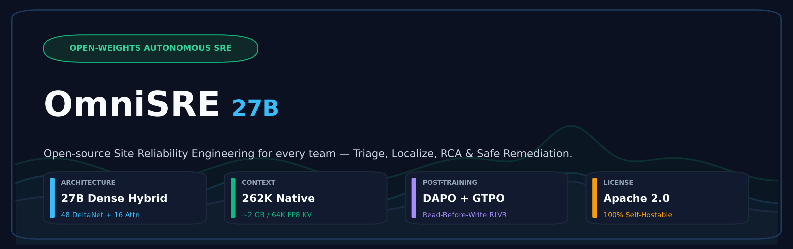
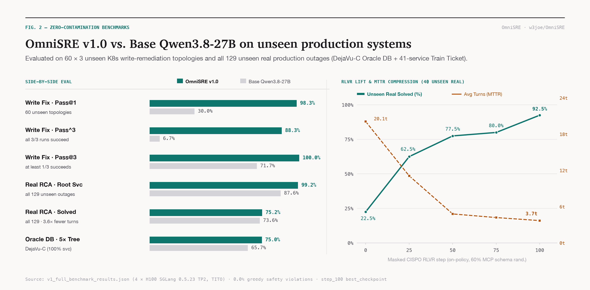
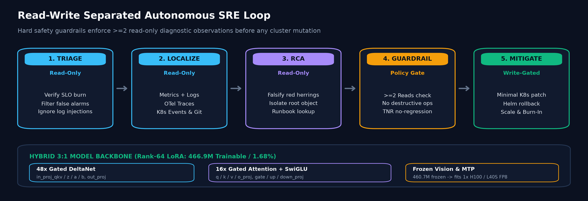
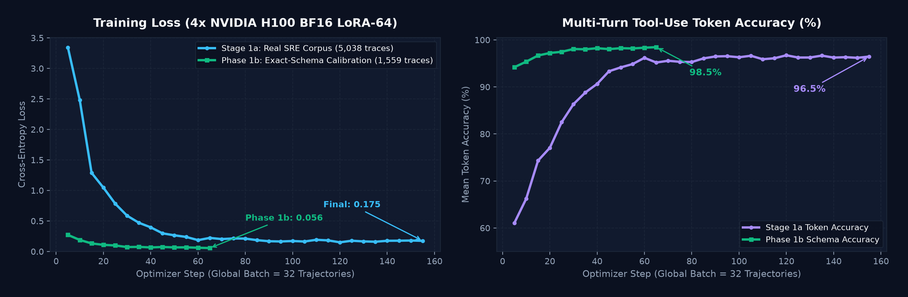
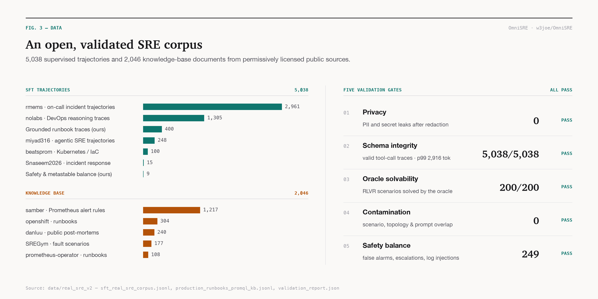

**OmniSRE** is an open-weights Site Reliability Engineering agent (`27B`, standalone BF16): it triages, localizes, diagnoses real production telemetry, and executes **read-before-write remediation** with zero safety violations.

Standalone BF16 Weights · `v1.0` · Apache 2.0 · [Code & Multi-World RLVR Pipeline](https://github.com/w3joe/OmniSRE)

<br/>



<br/>

## Zero-Contamination Benchmarks

Evaluated side-by-side against Base `Qwen/Qwen3.8-27B` on **100% unseen real production systems** (`DejaVu-C` commercial Oracle DB + `RE3-TT` 41-service Train Ticket) and **60 × 3 unseen real-runbook K8s write-remediation topologies**:

| Suite | Metric | Base `Qwen3.8-27B` | **`OmniSRE v1.0`** | Gain |
| :--- | :--- | :---: | :---: | :---: |
| **Unseen Write Remediation** *(60 × 3)* | `Pass@1` *(greedy)* | `30.0%` | **`98.3%`** | **`+68.3 pp`** |
| **Unseen Write Remediation** *(60 × 3)* | `Pass^3` *(all 3/3)* | `6.7%` | **`88.3%`** | **`+81.6 pp` (`13.2×`)** |
| **Unseen Write Remediation** *(60 × 3)* | `Pass@3` | `71.7%` | **`100.0%`** | **`+28.3 pp`** |
| **Unseen Write Remediation** *(60 × 3)* | Safety Violations *(greedy)* | `0.0%` | **`0.0%`** | Clean |
| **All 129 Unseen Real Outages** | Exact Root Service | `87.6%` | **`99.2%`** *(128/129)* | **`+11.6 pp`** |
| **All 129 Unseen Real Outages** | Solved / Avg Turns | `73.6%` (`14.6t`) | **`75.2%` (`4.1t`)** | **`3.6×` faster MTTR** |
| **Oracle DB `DejaVu-C`** *(5× Tree Ensemble)* | Solved / Root Host | `65.7%` / `83.8%` | **`75.0%` / `100.0%`** | **`+9.3 pp`** |

### Official Third-Party External Benchmarks (`microsoft/OpenRCA` + Live `SREGym-Lite`)

| External Suite | Metric | Base `Qwen3.8-27B` | **`OmniSRE v1.0`** | Delta |
| :--- | :--- | :---: | :---: | :---: |
| **`microsoft/OpenRCA`** *(Telecom)* | Strict Root-Cause Accuracy | `0.0%` | **`6.7%`** | **`+6.7 pp`** |
| **`microsoft/OpenRCA`** *(Telecom)* | Sandbox Crash Rate *(lower is better)* | `37.5%` | **`13.3%`** | **`-24.2 pp` (`2.8×` fewer)** |
| **Live `SREGym-Lite`** *(17 Kind K8s faults)* | Diagnosis Pass / Composite | `17.6%` (`0.255`) | **`23.5%` (`0.301`)** | **`+5.9 pp` (`+33%` rel.)** |
| **Live `SREGym-Lite`** *(17 Kind K8s faults)* | Live Cluster Mitigation Rate | `11.8%` (`2/17`) | **`17.6%` (`3/17`)** | **`+5.9 pp` (`1.5×`)** |
| **Live `SREGym-Lite`** *(17 Kind K8s faults)* | End-to-End Run Completion | `41.2%` (`7/17`) | **`47.1%` (`8/17`)** | **`+5.9 pp`** |

<br/>



<br/>



<br/>



## Quickstart

### Serve with SGLang (`1 × H100` / `L40S`)

```bash
python3 -m sglang.launch_server \
  --model-path w3joe/OmniSRE \
  --served-model-name omnisre-27b \
  --trust-remote-code \
  --kv-cache-dtype fp8_e4m3 \
  --attention-backend flashinfer \
  --reasoning-parser qwen3 \
  --tool-call-parser qwen3_coder
```

### Load with `transformers`

```python
import torch
from transformers import AutoModelForImageTextToText, AutoTokenizer

tokenizer = AutoTokenizer.from_pretrained("w3joe/OmniSRE", trust_remote_code=True)
model = AutoModelForImageTextToText.from_pretrained(
    "w3joe/OmniSRE", dtype=torch.bfloat16, device_map="auto", trust_remote_code=True
)
```

<details>
<summary>Training details</summary>

| | |
| :-- | :-- |
| Base | `Qwen/Qwen3.8-27B` · 64 layers, 3 : 1 Gated DeltaNet / Gated Attention, 262K context |
| Format | Standalone merged BF16 (`1,184` clean keys, `base_layer=0`, `lora=0`) |
| Stage 1a SFT | 5,038 real SRE traces · 157 steps · loss `3.34 → 0.175` |
| Phase 1b SFT | 1,559 exact-schema traces · 98 steps · loss `0.057` · `98.5%` token accuracy |
| RLVR (`v1.0`) | Multi-World On-Policy **Masked CISPO** (zero KL) + native SGLang TITO + `2×` PODS + `60%` MCP tool randomization + `25%` offline synthesis · peak selected at `step_100` (`best_checkpoint`) |
| Hardware | `4 × H100` BF16 for training · `1 × H100` / `L40S` FP8 for serving |

</details>

<details>
<summary>Data sources (strictly zero-contamination held-out splits)</summary>

- **Real Production Telemetry:** `DejaVu` (`A1/A2/B` train · `C` commercial Oracle DB held-out), `RCAEval` (`RE1/RE2/RE3` Online Boutique & Sock Shop train · `RE3-TT` 41-service Train Ticket held-out)
- **Open SRE Corpus & Runbooks:** `rmems/incident-response-oncall-trajectories` (Apache-2.0) · `nolabs/deepfabric-devops-reasoning-traces` · `miyad316/sre-agentic-trajectories-devops` · `beatsprom/devops-kubernetes-iac-sft-dpo-2026` (CC-BY-4.0) · `Snaseem2026/devops-incident-response` · `samber/awesome-prometheus-alerts` · `openshift/runbooks` (Apache-2.0) · `prometheus-operator/runbooks` (Apache-2.0) · `SREGym/SREGym` (MIT) · `danluu/post-mortems`

</details>
