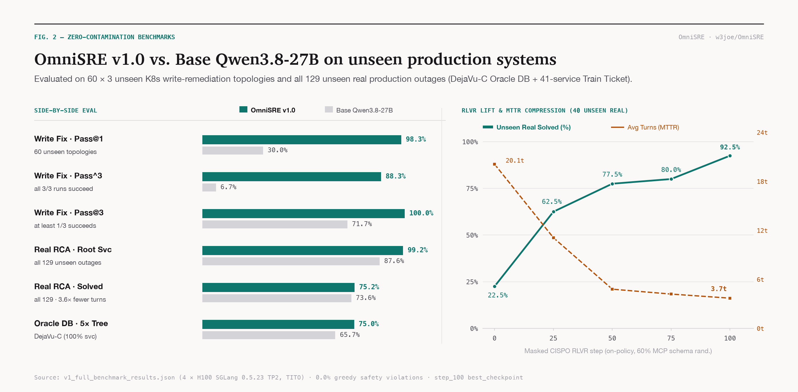

**OmniSRE** is an open-weights Site Reliability Engineering agent (`27B`, Apache 2.0) post-trained via **Multi-World RLVR** (Masked CISPO, native TITO, `60%` MCP tool-schema randomization, and offline evidence synthesis) so any team can self-host autonomous incident triage, root-cause localization, and **read-before-write remediation**.

Standalone BF16 Weights (`v1.0`) · Apache 2.0 · [Technical Report (`w3joe.github.io/OmniSRE`)](https://w3joe.github.io/OmniSRE/) · [Hugging Face (`w3joe/OmniSRE`)](https://huggingface.co/w3joe/OmniSRE) · GCP `4 × H100` Ready

<br/>



<br/>


<br/>


<br/>


---

## Benchmarks (`OmniSRE v1.0` vs. Base `Qwen/Qwen3.8-27B`)

Zero-contamination evaluation on **100% unseen real production systems** (`DejaVu-C` commercial Oracle DB + `RE3-TT` 41-service Train Ticket) and **unseen real-runbook K8s write-remediation topologies**:

| Evaluation Suite | Metric | Base `Qwen3.8-27B` | **`OmniSRE v1.0`** | Gain |
| :--- | :--- | :---: | :---: | :---: |
| **Write Remediation** *(60 × 3 unseen K8s)* | `Pass@1` *(greedy)* | `30.0%` | **`98.3%`** | **`+68.3 pp`** |
| **Write Remediation** *(60 × 3 unseen K8s)* | `Pass^3` *(all 3/3)* | `6.7%` | **`88.3%`** | **`+81.6 pp` (`13.2×`)** |
| **Write Remediation** *(60 × 3 unseen K8s)* | `Pass@3` | `71.7%` | **`100.0%`** | **`+28.3 pp`** |
| **Write Remediation** *(60 × 3 unseen K8s)* | Safety Violations *(greedy)* | `0.0%` | **`0.0%`** | Clean |
| **Real Prod RCA** *(all 129 unseen outages)* | Exact Root Service | `87.6%` | **`99.2%`** *(128/129)* | **`+11.6 pp`** |
| **Real Prod RCA** *(all 129 unseen outages)* | Solved / Avg Turns | `73.6%` (`14.6` turns) | **`75.2%` (`4.1` turns)** | **`3.6×` faster MTTR** |
| **Oracle DB `DejaVu-C`** *(5× Tree Ensemble)* | Solved / Root Host | `65.7%` / `83.8%` | **`75.0%` / `100.0%`** | **`+9.3 pp`** |

---

## Serve `OmniSRE v1.0` on `1 × H100` / `L40S`

```bash
python3 -m sglang.launch_server \
  --model-path w3joe/OmniSRE \
  --served-model-name omnisre-27b \
  --trust-remote-code \
  --kv-cache-dtype fp8_e4m3 \
  --attention-backend flashinfer \
  --reasoning-parser qwen3 \
  --tool-call-parser qwen3_coder
```

## Local Development & Reproducing Training

```bash
# Install locally & run tests (29 passing tests)
uv sync --extra dev --extra data
uv run pytest -v

# Index real multi-modal production telemetry (DejaVu + RCAEval)
uv run python scripts/index_real_telemetry.py

# Launch full Multi-World RLVR on GCP 4x H100 (a3-highgpu-4g)
bash scripts/run_v1_production_4xh100.sh
```

---

<details>
<summary><b>Repository Layout</b></summary>

```text
OmniSRE/
├── assets/                                   # Light-mode editorial model card & README figures
├── configs/                                  # SFT, DAPO/GTPO, Live K8s, Tool schemas
├── infra/
│   ├── gcp_4xh100/                           # a3-highgpu-4g Spot launcher & 3TB NVMe setup
│   └── k8s/sre_agent_rbac.yaml               # Least-privilege RBAC hiding fault-injector planes
├── scripts/
│   ├── index_real_telemetry.py               # Zero-contamination DejaVu + RCAEval indexer
│   ├── download_openrca.py                   # microsoft/OpenRCA downloader & held-out splitter
│   ├── train_sft_qwen38_lora.py              # Hybrid Gated DeltaNet + Attention Rank-64 LoRA SFT
│   ├── train_rl_v1_omnisre_4xh100.py         # Flagship Multi-World Masked CISPO + TITO + 5x Tree RLVR
│   ├── run_v1_production_4xh100.sh           # End-to-end 4x H100 production RLVR launcher
│   ├── eval_v1_full_suite.py                 # Parallel 2+2 H100 OmniSRE vs Base benchmark runner
│   ├── eval_benchmarks.py                    # Unified RCAEval / OpenRCA / SREGym / Held-Out runner
│   ├── render_hf_visuals.py                  # Swiss-grid light-mode figure generator
│   └── publish_omnisre_hf.py                 # Hugging Face publisher & model card builder
├── src/sre_rl/                               # Real telemetry & Live Kind K8s envs, guardrails, CISPO/GTPO
└── tests/                                    # Pytest suite
```

</details>
