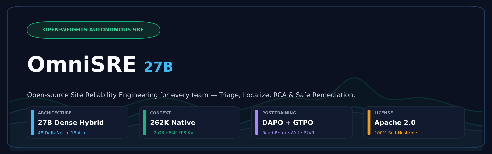
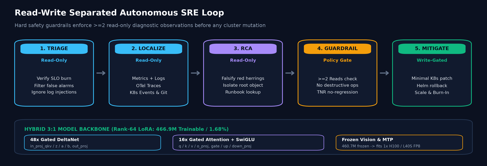
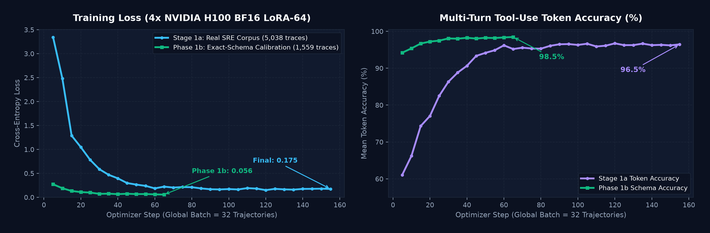
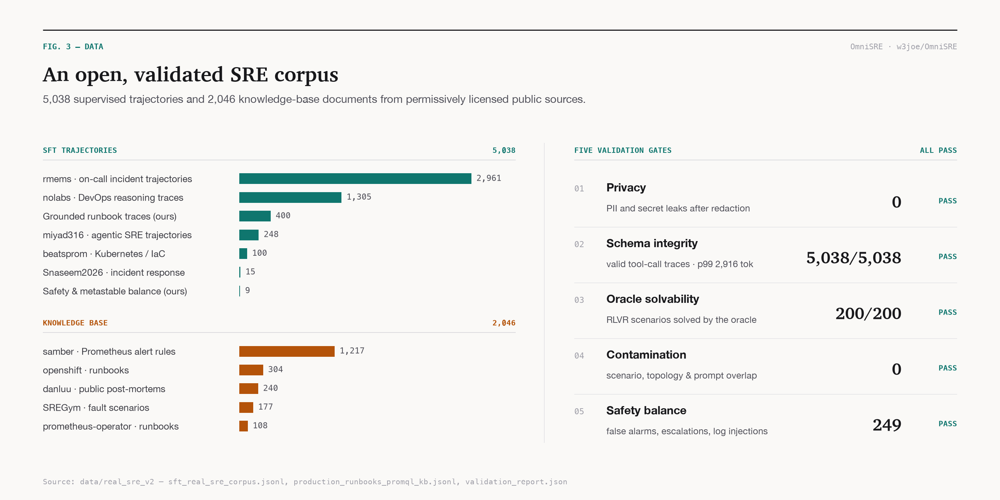

**OmniSRE** is an open-weights Site Reliability Engineering agent and end-to-end RLVR post-training pipeline (Multi-Turn **DAPO + GTPO**), built so any team can self-host autonomous incident triage, localization, root-cause analysis, and read-before-write remediation.

Apache 2.0 · [Hugging Face Weights (`w3joe/OmniSRE`)](https://huggingface.co/w3joe/OmniSRE) · GCP `4 × H100` (`a3-highgpu-4g`) Ready

<br/>



<br/>



<br/>



---

## Quickstart

```bash
# Install locally & run tests (22 unit + integration tests)
uv sync --extra dev --extra data
uv run pytest -v

# Scrape, scrub & run the 5-Gate Validator on the open SRE corpus
uv run python scripts/scrape_real_sre_dataset.py --output-dir data/real_sre_v2
uv run python scripts/validate_sre_dataset.py --dataset-dir data/real_sre_v2
```

## Benchmarks (`Base` vs. `OmniSRE-27B`)

Run side-by-side evaluations against any OpenAI-compatible SGLang / vLLM server across **`RCAEval`**, **`OpenRCA`**, **`SREGym`**, and our de-contaminated held-out suite — either as a fast **`--mode subset`** smoke run or **`--mode full`** leaderboard run:

```bash
# Fast subset (~15-20 min on 1x H100 via SGLang)
uv run python scripts/eval_benchmarks.py \
  --mode subset \
  --benchmarks internal_heldout rcaeval openrca \
  --model omnisre-27b \
  --endpoint-url http://127.0.0.1:30000/v1

# Full side-by-side run (Qwen3.8-27B Base vs. OmniSRE-27B)
bash scripts/run_benchmarks_sglang.sh --mode subset --benchmarks "internal_heldout rcaeval openrca sregym"
```

---

<details>
<summary><b>Repository Layout</b></summary>

```text
OmniSRE/
├── assets/                                   # Light-mode editorial model card figures
├── configs/                                  # SFT, Tier-1 DAPO+GTPO, Tier-2 Live K8s, Tool schemas
├── infra/
│   ├── gcp_4xh100/                           # a3-highgpu-4g Spot launcher, Terraform, 3TB RAID-0 NVMe setup
│   └── k8s/sre_agent_rbac.yaml               # Least-privilege RBAC hiding fault-injector planes
├── scripts/
│   ├── scrape_real_sre_dataset.py            # Multi-source open SRE corpus scraper
│   ├── validate_sre_dataset.py               # 5-Gate PII, schema, oracle & contamination validator
│   ├── build_phase1b_sft_dataset.py          # Phase 1b exact-schema SFT calibration builder
│   ├── train_sft_qwen38_lora.py              # Hybrid Gated DeltaNet + Attention Rank-64 LoRA SFT
│   ├── train_rl_sglang_4xh100.py             # 10x faster Split-GPU SGLang TP2 + DDP RLVR trainer
│   ├── run_v4_sglang_4xh100.sh               # Full Run-v4 launcher (Phase 1b SFT -> SGLang RLVR)
│   ├── eval_benchmarks.py                    # Unified RCAEval / OpenRCA / SREGym / Held-Out runner
│   ├── bootstrap_kind_sregym_pool.sh         # 8-cluster isolated Stage 3 Kind sandbox pool
│   └── publish_omnisre_hf.py                 # Hugging Face publisher & model card generator
├── src/sre_rl/                               # Core envs, guardrails, rewards, DAPO/GTPO, veRL hooks
└── tests/                                    # Pytest suite
```

</details>

<details>
<summary><b>Training & Serving on GCP 4 × H100 (`a3-highgpu-4g`)</b></summary>

```bash
# 1. Provision GCP a3-highgpu-4g Spot VM (4x H100 80GB, 104 vCPUs, 3TB Local NVMe)
export GCP_PROJECT_ID="your-gcp-project"
bash infra/gcp_4xh100/provision_a3_4g.sh

# 2. Launch Phase 1b SFT + Split-GPU SGLang TP2 (GPUs 0,1) + DDP RLVR (GPUs 2,3)
bash scripts/run_v4_sglang_4xh100.sh

# 3. Serve OmniSRE-27B on 1x H100 / L40S in FP8
bash scripts/serve_flash_sglang.sh

# 4. Publish checkpoint & visual model card to Hugging Face
uv run hf auth login
uv run python scripts/publish_omnisre_hf.py \
  --repo-id w3joe/OmniSRE \
  --gcs-checkpoint gs://<bucket>/omnisre-v4/omnisre-27b-rl-dapo-gtpo \
  --stage-label "v0.2-rlvr"
```

</details>
